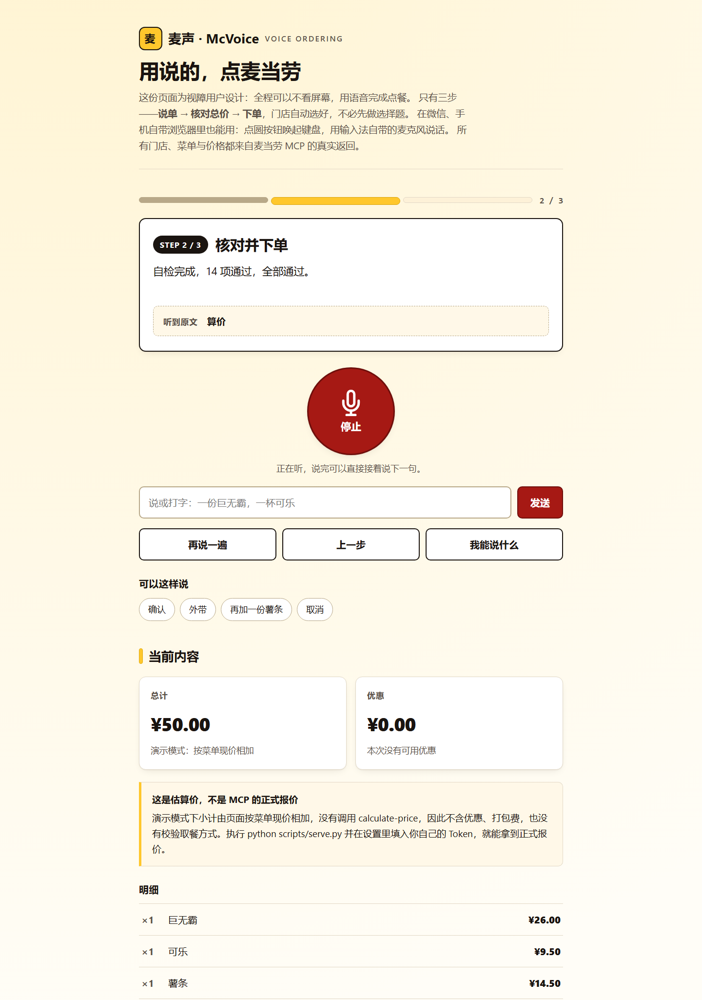

# 麦声 · McVoice

> **用说的，点麦当劳。** 为视障用户设计的语音点餐：全程可以不看屏幕，三步点完一单。

打开麦当劳小程序，视障用户面对的是一连串读不出来的图片按钮和弹层。麦声把整条流程还原成
一场**对话**：我念当前状态，你说话就行——不用先选门店、不用一道道确认。



手机（390px，微信键盘通道）实拍：[docs/preview-mobile.png](docs/preview-mobile.png)

**在线体验（无需安装，也可以全程用键盘走完）：https://calvino-y.github.io/mcd-mcvoice/**

**想用自己账号真实下单？** 把仓库拉下来跑 `python scripts/serve.py`，页面上填自己的 MCP Token，
就能拉取**你自己的**附近门店、实时菜单和真实报价，直到创建订单拿到支付链接——
详见 [本地工具模式](#本地工具模式token-不离开你的本机)。

完整页面长图（含 14 项无障碍自检结果）：[docs/preview-full.png](docs/preview-full.png)

## 它解决什么问题

主流点餐界面为视力正常的人设计：轮播图、宫格图标、悬浮弹层。对视障用户意味着：

- **找不到入口**——图标没有可读的替代文本，屏幕阅读器念出来是「按钮 按钮 图片」
- **跟不流程**——弹层一开，焦点乱跳，读到一半不知道自己进行到哪一步
- **不敢确认**——金额、门店、取餐方式藏在视觉角落里，听不到就敢不下单

麦声的答案不是「给页面加一点 aria」，而是**把流程整个翻转成语音优先**：
页面只负责把当前状态说出来、把该说的话列出来，点餐本身是一场对话。

## 快速开始

```bash
git clone https://github.com/Calvino-Y/mcd-mcvoice.git
cd mcd-mcvoice

# 演示模式：零依赖，直接双击 docs/index.html 或起个静态服务都行
# 本地模式（真实数据 + 真实下单）：零依赖，只用 Python 标准库
python scripts/serve.py
```

浏览器会自动打开 `http://127.0.0.1:8765`。在「设置」里填入你的 MCP Token（申请：
<https://open.mcd.cn/mcp>，免费）并点连接，然后按「开始使用」说话就行。

**没有麦克风、环境太吵、或者你就在用屏幕阅读器？** 页面下方的打字输入框走的是同一条
理解管道，能完成一模一样的流程——这不是附属功能，是降级路径，有专门的测试守着。

## 三步流程

第一版有八步（欢迎→门店→点餐→购物车→报价→确认→下单→完成），每一步先念一段引导。
真实用起来，一个已经知道自己要什么的用户平均要说四五轮才能走完一单——「过渡太长、
沟通太累」。现在只有三步：

| 步骤 | 我会说 | 你可以说 |
|---|---|---|
| 1 说单 | 门店已自动选好，直接说想吃什么 | 「来一份巨无霸和一杯可乐」「加一杯可乐」「不要薯条了」「换门店」 |
| 2 核对 | 一共 4 件，总计 ¥64.50，取餐方式堂食 | 「确认」「外带」「再加一份薯条」 |
| 3 完成 | 订单已创建 / 演示模式不会创建订单 | 「再点一单」 |

砍掉的不只是步骤，还有两道**默认替你答好的选择题**：门店自动选最近一家有菜单的（说
「换门店」随时改）；取餐方式默认堂食（说「外带」当场改）。点单过程中每加一件都念小计，
你随时知道现在多少钱——不必专门喊一声「算价」。说「就这些」直接进入核对，跳过原来的
购物车与报价两个中间步骤。

任何时刻都可以说「再说一遍」「取消」「我能说什么」——控制指令在**任何步骤、
任何追问等待中**都优先放行，不会被歧义追问吞掉。

## 说话的三条通道（微信、手机自带浏览器也能用）

第一版依赖浏览器原生的 `SpeechRecognition`，实测只有桌面 Chrome / Edge 能用：
**微信内置浏览器和绝大多数手机自带浏览器根本没有这个 API**，国内的安卓 Chrome
也因为没有可用的识别服务而失败。「只能在 Google 浏览器用」不是代码写错了，
是这个 API 在中国用户的手机上等于不存在。现在按环境自动走三条通道：

| 通道 | 环境 | 体验 |
|---|---|---|
| **native** | 桌面 Chrome / Edge | 按一下连续说话（原来的方式） |
| **keyboard** | 微信、手机自带浏览器 | 点圆按钮 → 系统键盘弹出 → **按键盘上的 🎤 说话**，回车即发送。手机输入法的中文识别是厂商专门优化过的，通常比网页识别更准 |
| **cloud** | 任何浏览器（可选） | 在设置里填一个你自己的转写接口地址，圆按钮变成「按一下录音、说完再按一下」 |

键盘通道里，输入框不是备选项而是主入口：点圆按钮会把焦点送过去并唤起键盘（这一步
必须发生在点击事件的同步路径里，否则移动端不弹键盘）；输入时**边打边显示「我理解成了
什么」**——「巨无霸」还是被听成了「巨无把」，在按下发送之前就能看见并改正，而不是
加购错了再退。

云端通道默认关闭、不预置任何地址：接口约定是最小形态的 `POST <endpoint>`，
body 为 `audio/webm` 录音，返回 `{"text": "识别结果"}`。用云函数包一层
腾讯云一句话识别或讯飞即可接入，页面零改动。

## 它听得懂什么

语音识别（Web Speech API，`zh-CN`）转出来的文字经常不是你说的那句话。麦声的理解层为此做了四层处理：

**① 口语别名（86 条）。** 没人会照着菜单念「龙焰芝士棒鸡腿堡三件套」，大家说的是
「巨无霸」「可乐」「薯条」「甜筒」「1+1」。别名表把口语词映射到真实商品编码，构建时逐条校验
指向的编码必须存在——写错一个就当场构建失败，绝不让「说了没反应」的别名上线。

**② 同音误听纠正（27 条）+ 拼音容错层（3766 字）。** 「巨无八」→ 巨无霸、「麦乐机」→ 麦乐鸡、
「数条」→ 薯条、「安格丝」→ 安格斯。手写表只收确定是误听的，不收可能另有含义的——它覆盖
不到的情形交给**拼音层**：识别错的字绝大多数是同音字（「可乐」听成「渴乐」），拼音层把整句话
转成音节序列再比，任何同音错法都能救回来。表在构建期用 pypinyin 算好（覆盖 GB2312 一级
汉字 3766 字，按音节分组压到 16 KB，运行时零依赖，只查表），平翘舌和前后鼻音再归并一次
模糊比对（「苏条」也能找回薯条）。表必须比菜单宽——**错字天生是菜单外的字**，只收菜单用字
的表在最该救的时刻必然失效。

**③ 整段读音嵌进名字 = 核心词命中。** 中文商品名是「修饰语 + 核心词」，核心词在后面。
用户把「蘸酱炸鸡」说成「咋鸡」时只有 2/4 个音节对上，光看比例会判成「没听懂」；但「你说的
整段读音原封不动就是它名字的结尾」是很硬的证据。反过来「薯条」是「薯条脆卜卜毛绒周边」的
**开头**——那是用户只说出了修饰语的一半，不能算认出了这件周边。拼音层对这两种情形分别
处理：嵌在名字中后段给分、嵌在开头不给。

**④ 一句话多样。** 「来一份巨无霸和一杯可乐」一句话进两件；「再来两份薯条」数量解析正确——
数量词正则曾经静默失效过（意图对、商品对、只有份数悄悄错掉，页面零报错），现在有专门的
断言组盯着这件事。

**⑤ 听不懂就问，说得清就别问（三层优先级）。**
完整商品名精确命中 → 直接采纳；并列候选里「不带后缀的单品」唯一 → 认定单品、顺口提一句还有
三件套；其余 → 念出候选让你选。泛化的「三件套」「单人餐」这类规格词**刻意不进别名表**——
收过，结果用户说「巨无霸三件套」时把「大堡口福三件套」也拉进候选，反过来追问一个刚刚说得很清楚的人。

**⑥ 识别不准时，把判断权交回给你。** 代码无法保证识别永远正确，但可以保证你分得清
「没听见」和「听错了」：说话过程中实时回显中间结果；说完如实显示「听到原文」；识别器一次给
多个转写候选，页面挑出**真正被理解的那句**并注明「按『××』理解」；实在没听懂时念出识别
原文（「我听到的是『××』，但没认出是哪个」），而不是笼统一句「没听懂」。

## 界面：为「听得见」的人也留一条路

暖白纸面 + 品牌黄 + 深红行动色的三层配色（对比度全部按 WCAG AAA 实算：正文 18.2:1、
次要文字 7.8:1、主按钮 7.6:1）；圆形麦克风是唯一的主行动，按下去有呼吸环提示「还在听」；
3 格进度条让你随时知道流程走到哪。开关和滑杆统一 `accent-color`，不留浏览器默认蓝。
字号 20px 起步可调 160%，全程可纯键盘操作，打字输入与语音走同一条理解管道。

**选门店**同理：门店官方名共享很长的前缀（都是「麦当劳成都…」），按字覆盖率打分会让任意两家
都接近满分、永远判成歧义。所以用的是**最长公共子串**打分，实测「麦当劳天府三街餐厅」能唯一
指向目标门店，与第二名分差足够大。

## 无障碍不是口号，是被验证的清单

| 设计 | 说明 |
|---|---|
| 全程语音 | 每一步的状态、购物车、报价、候选都念出来；`aria-atomic` 保证整句重读 |
| 播报不自我打断 | 页面朗读前 `cancel()`、拾音在朗读期间暂停，避免「自问自答」 |
| 与屏幕阅读器共存 | 设置里可一键关掉页面朗读，改由你的 NVDA / TalkBack 念，内容一样不少 |
| 键盘完全可用 | 跳转链接、唯一 main 地标、无 tabindex 正数、无键盘陷阱；打字输入走同一条管道 |
| 焦点看得见 | 双色焦点环（白圈 + 黑环），在任意背景上都可见 |
| 字够大 | 根字号 20px 起步，页内可调至 160%，viewport 不禁缩放 |
| 对比度 | 正文对比度 ≥ 7:1（AAA），另适配 `prefers-contrast: more` |
| 触控目标 | 主要按钮实际高度 52px，远超 WCAG 2.5.8 的 24px 下限 |
| 动效 | 本页没有动画，并显式声明 `prefers-reduced-motion` 防止将来忘掉 |

**双重验证，结果如实展示：**

- **页面内置自检（14 项）**：可访问名称、对比度（真实合成背景色，透明逐级上溯）、触控尺寸、
  焦点可见、tabindex、播报区域、横向溢出……在页面里点「运行自检」就能看到，?audit=1 自动跑
- **axe-core 4.10.2 第三方审计**：无头浏览器里跑 WCAG 2.0/2.1 A + AA + best-practice，
  当前 **0 违规**（`tests/browser_check.py` 每次提交都重新验证）

## 不可逆动作，两道闸门

创建真实订单是本工具唯一不可逆的动作：

1. 页面上的「允许创建订单」开关**默认关闭**。关闭时流程只走到「算出总价」为止，
   说「堂食」「外带」都会得到如实说明并安全收尾，绝不产生订单。
2. 打开开关后，还要经过步骤 6 的「下单前确认」，服务端（`serve.py`）再要求一次显式
   `confirm: true`——任何形式的误触发都到不了 `create-order`。

付款永远由你本人在麦当劳官方渠道扫码完成，**本工具不代付**。

演示模式（GitHub Pages）即使打开开关也不会创建订单——它根本没有后端，这一点在页面上写明了。

## 本地工具模式（Token 不离开你的本机）

```bash
python scripts/serve.py            # 自动打开浏览器
python scripts/serve.py --port 8765 --no-browser
```

- 实时拉取**你的**附近门店（换城市也准）、所选门店的实时菜单、`calculate-price` 真实报价
- 报价里能拿到真实的取餐方式列表（`takeWayList`），下单用它，不写死
- 顺带播报你卡包里的券（能播报哪些券、什么时段能用；为什么不自动套券见下文「诚实口径」）

**为什么必须有本地服务，而不能让网页直接调 MCP？** 实测 `https://mcp.mcd.cn` 的响应
**不带 CORS 头**（OPTIONS / POST 均返回 403）。这不是缺陷，是安全设计——MCP Token
本就不该交给浏览器保管。所以由本地进程代调 MCP，网页只跟 `127.0.0.1` 说话。

安全闸门（`tests/test_serve.py` 端到端逐条验证）：

| 防线 | 行为 |
|---|---|
| 只绑定 `127.0.0.1` | 局域网内其他设备连不上 |
| `Host` 头校验 | 防 DNS rebinding，伪造域名连页面都拿不到 → 403 |
| 跨站 `Origin` 拒绝 | 其他网页无法借你的浏览器调用本地 API → 403 |
| `OPTIONS` 预检 | 一律 403，不提供任何跨域能力 |
| 会话密钥 | 每次启动随机生成，`/api/*` 必须携带 `X-McVoice-Key` → 401 |
| Token 不落盘 | 只在内存；不回显；注入页面前做泄漏形态扫描 |
| 下单二次确认 | `/api/order` 缺 `confirm: true` → 400 |
| 降级友好 | 未连接账号时业务接口返回 409 并提示，而不是 500 崩掉 |

## 诚实口径

这个项目宁可少做一个功能，也不假装做一个。三条写进代码和文档的边界：

1. **演示快照只覆盖采样那一家门店。** 门店列表里其他 4 家会明确标注「无菜单快照」，
   选中时如实说明并留在原地——绝不拿别家店的菜单价格替这一家点餐。「数字看起来对，
   但对应的不是这家店」是最隐蔽的错误。
2. **演示模式的报价是估算。** 小计按菜单现价相加，页面明确标注「这是估算，不是 MCP 的
   正式报价」，因为它没有调用 `calculate-price`，不含优惠与打包费；本地模式才是真实报价。
3. **券只播报，不假装自动套用。** `query-my-coupons` / `available-coupons` 的返回里
   没有 `couponId` / `couponCode`，而套券恰恰必须传这两个字段——纯 MCP 链路目前拿不到
   可回填的券 ID。所以本项目只做到「语音念出有哪些券、什么时段能用」，这个限制原文写进了
   数据集的 `couponLimitation` 字段，可以直接读给用户听。

## 验证链

改任何东西之后，四条检查都要跑（共 **270+ 项断言**）：

```bash
node tests/check_page.mjs          # 页面结构自检：占位符/语法/数据自洽/无障碍骨架/三步流程/说话通道（102 项）
node tests/test_voice.mjs          # 语音理解核心：真实菜单喂「人真的会这么说」的句子（115 项）
python tests/test_serve.py         # 本地代理安全闸门端到端测试（18 项）
python tests/browser_check.py      # 无头浏览器真跑两遍：完整流程 + axe 审计 + 微信降级路径（39 项）
```

其中 `test_voice.mjs` 把页面里 `VOICE` 标记之间的纯函数原样抽出来执行——测试的代码就是
线上跑的代码，不存在「测的是 A、上线的是 B」。

## 项目结构

```
mcd-mcvoice/
├── SKILL.md                      # WorkBuddy Skill 定义（本仓库根目录即 Skill 目录）
├── scripts/
│   ├── mcp_client.py             # 麦当劳 MCP 客户端（标准库实现 Streamable HTTP，零依赖）
│   ├── build_menu.py             # 原始快照 -> data/menu.json（含口语别名表与构建期校验）
│   ├── build_pinyin.py           # 拼音容错表（GB2312 一级汉字 3766 字 -> data/pinyin_table.json）
│   ├── render_app.py             # 模板 + 数据 -> docs/index.html
│   └── serve.py                  # 本地工具模式：MCP 代理 + 安全闸门（零依赖）
├── data/
│   ├── stores_raw.json           # query-nearby-stores 真实快照（5 家门店）
│   ├── menu_raw.json             # query-meals 真实快照（122 项餐品 / 15 类目）
│   ├── price_raw.json            # calculate-price 真实快照（含 observedNotes）
│   ├── coupons_raw.json          # query-my-coupons 结构化快照（8 张券 + 限制说明）
│   ├── menu.json                 # 整理后的数据集（页面直接可用）
│   └── pinyin_table.json         # 拼音表（音节 -> 汉字串，16 KB，运行时只查表）
├── assets/
│   └── app-template.html         # 页面模板（演示 / 本地双模式，语音理解核在 VOICE 标记内）
├── docs/
│   ├── index.html                # 可在线点开的页面（GitHub Pages）
│   ├── preview-top.png           # README 头图
│   └── preview-full.png          # 完整页面长图（含自检结果）
├── references/
│   └── mcp-tools.md              # MCP 工具参数速查（含实测踩坑记录）
├── CONTEST_DECLARATION.md        # 参赛声明
└── tests/
    ├── check_page.mjs            # 页面结构自检（102 项）
    ├── test_voice.mjs            # 语音理解核心单测（115 项）
    ├── test_serve.py             # 安全闸门端到端测试（18 项）
    ├── make_mobile_preview.py    # 手机宽度（390px）截图验收
    ├── browser_check.py          # 无头浏览器两遍：全流程 + axe + 微信降级路径
    ├── make_preview.py           # 生成 README 预览图
    └── vendor/axe.min.js         # axe-core 4.10.2（Deque，MPL-2.0）
```

## 作为 WorkBuddy Skill 安装

```bash
git clone https://github.com/Calvino-Y/mcd-mcvoice.git \
  ~/.workbuddy/skills/mcd-mcvoice
```

然后在 WorkBuddy 里说「帮我用语音点麦当劳」或「麦克声，来一份巨无霸」，Skill 会自动触发。

## 数据来源

全部来自麦当劳 MCP 服务的真实返回，**没有任何人工编造的数字**：

| 数据 | MCP 工具 |
|---|---|
| 附近门店（名称/地址/距离/营业状态） | `query-nearby-stores` |
| 菜单（122 项餐品 / 15 类目） | `query-meals` |
| 真实报价与取餐方式 | `calculate-price` |
| 卡包券（只播报，见诚实口径） | `query-my-coupons` |

采样门店：麦当劳成都天府三街餐厅（`storeCode=3450121`），采样日期 2026-10-15。

## 无障碍反馈

这版页面为视障用户而做，但做得好不好要由真实使用者说了算。如果你在使用中遇到任何
「听不到、念不对、跟不上」的问题，欢迎提 Issue，描述当时的说法与步骤即可——
「说了没反应」这类问题尤其欢迎，它们正是这条验证链存在的原因。

## 免责声明

本项目为**麦当劳程序员节创意开发大赛参赛作品**，由参赛者独立开发，非麦当劳官方产品。

餐品信息、价格及供应状态以麦当劳官方渠道的实时结果为准。创建订单后请在麦当劳官方渠道
完成支付与售后，本工具不代付、不存储任何账号凭证。

## License

MIT
